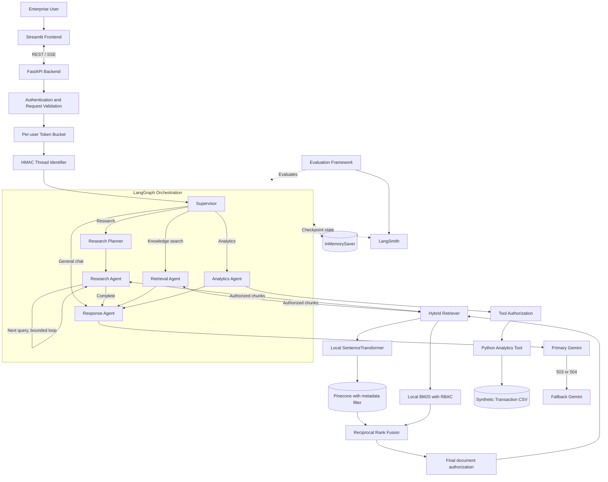

# Enterprise AI Knowledge Agent

An enterprise AI assistant proof of concept for banking and financial services, demonstrating agentic orchestration, hybrid retrieval, secure tool execution, conversational memory, observability and systematic evaluation.

## 1. Overview

The application helps employees search organizational knowledge, investigate operational incidents, summarize policies and runbooks, and analyze synthetic payment transactions. It demonstrates how an enterprise assistant can combine LLM capabilities with explicit workflow control and backend authorization.

All demonstration documents and transaction records are synthetic. The application is not connected to a live banking system.

## 2. Key Features

- Streamlit multi-turn chat with streamed agent activity and source attribution.
- Asynchronous FastAPI REST and Server-Sent Events (SSE) endpoints.
- LangGraph supervisor, retrieval, research, analytics and response nodes.
- Bounded RLM-inspired research across document chunks.
- Pinecone dense retrieval, local BM25 sparse retrieval and Reciprocal Rank Fusion (RRF).
- Google Gemini primary and fallback models.
- Session-scoped conversation memory, API-key authentication, document and tool RBAC, and per-user token bucket rate limiting.
- LangSmith tracing and deterministic, semantic, groundedness and security evaluation.

## 3. System Architecture



The diagram shows logical dependencies and workflow routes. The evaluation framework is a developer-side component, not a public API exposing retrieved document text.

## 4. Technology Stack

| Layer | Technology |
|---|---|
| Language | Python 3.13 (development environment) |
| Frontend | Streamlit |
| Backend | FastAPI, Uvicorn, Pydantic, HTTPX |
| Orchestration | LangGraph, LangChain |
| LLM | Google Gemini, configurable primary and fallback |
| Embeddings | SentenceTransformers all-MiniLM-L6-v2 (384 dimensions) |
| Retrieval | Pinecone, rank-bm25, RRF |
| Memory | LangGraph InMemorySaver |
| Observability | LangSmith, Python logging |
| Testing | pytest, pytest-asyncio, unittest.mock |

## 5. Agent Architecture and Workflow

| Component | Responsibility |
|---|---|
| Supervisor | Classify the latest question and reset request-scoped state. |
| Retrieval | Retrieve relevant authorized document chunks. |
| Research planner | Decompose a question into targeted search queries. |
| Research agent | Execute a bounded sequence of searches and merge evidence. |
| Analytics | Authorize and invoke the Python transaction analysis tool. |
| Response | Generate a final answer using relevant evidence or tool results. |

The supervisor uses deterministic keyword-based routing to select `general_chat`, `knowledge_search`, `research` or `analytics`. Conditional graph edges make execution predictable and testable. The nodes share typed state containing messages, intent, sources, research progress, analytics results, authenticated identity and activity information.

The application exposes execution steps and supporting evidence rather than private model reasoning. SSE streams workflow progress; the final generated answer is delivered in the completion event, rather than token-by-token generation.

## 6. RLM-Inspired Research Implementation

The research workflow demonstrates a simplified interpretation of Recursive Language Model concepts. Instead of loading the complete document collection into the model context, it:

1. Builds a Python-based search plan from the question.
2. Decomposes the investigation into targeted queries.
3. Retrieves authorized chunks for each query.
4. Repeats retrieval for up to three research steps.
5. Merges and deduplicates retrieved evidence.
6. Synthesizes findings from a bounded context in the response agent.

For a payment incident investigation, the planner searches the original question, incident root causes and resolutions, and relevant recovery procedures. The response distinguishes documented events from recommendations.

This is bounded iterative exploration, not a full RLM runtime with dynamically generated recursive programs or independently invoked recursive LLM sub-agents. The bounded approach limits execution cost and complexity, but may miss evidence in larger collections.

## 7. Hybrid Retrieval Architecture

Documents are parsed into text chunks with metadata such as title, source, department, document type, access level and creation date. Chunk identifiers are derived from the filename and chunk number.

Dense retrieval uses normalized 384-dimensional local embeddings and Pinecone namespace and metadata filtering. Sparse retrieval uses BM25 over locally loaded document chunks. Each branch contributes up to ten ranked candidates.

Reciprocal Rank Fusion combines the rankings:

`RRF(d) = sum(1 / (60 + rank_i(d)))`

Ranks start at one. RRF avoids requiring dense and sparse scores to share a common numerical scale. Authorization and optional department checks are applied before returning results. The default retrieval limit is four chunks, and the response agent uses a bounded evidence context with numbered citations.

The current implementation requires the dense search to succeed before sparse search runs. Automatic BM25-only recovery during a Pinecone outage is deferred.

## 8. Conversational Memory

LangGraph InMemorySaver maintains conversation state across turns within a running backend process. The server derives a thread identifier using HMAC-SHA256 over the authenticated user identity and client session identifier, with a server-side secret. This prevents two different demo users from sharing a checkpoint simply by supplying the same session ID.

Request-specific retrieval and analytics state is reset for each turn while conversation messages are retained. Integration tests verify same-user recall and cross-user isolation. Memory is not durable across restarts, is not shared across workers, and does not implement permission-revocation handling or history compaction.

## 9. Tool Integration and Analytics

The knowledge search capability is implemented as a retrieval node. The analytics agent invokes a LangChain-decorated Python tool, `analyze_transactions`, after checking the authenticated role. The tool reads a fixed synthetic CSV file and calculates statistics deterministically rather than asking the LLM to perform arithmetic.

| Metric | Demo value |
|---|---:|
| Total transactions | 10 |
| Successful transactions | 7 |
| Failed transactions | 3 |
| Success rate | 70% |
| Total successful amount | 1370.50 |
| Average latency | 1313 ms |

The analytics tool is read-only and parameterless. It does not accept arbitrary code, file paths or production transaction requests. Tool selection is controlled by the graph. MCP server and client integration are deferred; the Python tool is not an MCP tool.

## 10. Security and Guardrails

### Authentication and authorization

The backend authenticates demo API keys supplied through the `X-API-Key` header. User identity and role are derived from server configuration, not from the user prompt. Missing or invalid keys are rejected with HTTP 401.

| Capability | Viewer | Engineer (Analyst) | Admin |
|---|---|---|---|
| General chat | Yes | Yes | Yes |
| Public documents | Yes | Yes | Yes |
| Internal Engineering documents | No | Yes | Yes |
| Other internal documents | No | No | Yes |
| Restricted documents | No | No | Yes |
| Transaction analytics | No | Yes | Yes |

The `engineer` role represents the assignment's Analyst role for the implemented capabilities. Unknown roles and unknown document access classifications are denied. Pinecone metadata filters, local BM25 authorization checks and final result checks provide defense in depth.

### Prompt injection and output safeguards

System instructions treat user and retrieved document content as untrusted data, prohibit embedded instruction overrides, and require evidence-based answers. Tool permissions are enforced in Python independently of model behavior. Request schemas constrain message and session identifier lengths. Citation validity is checked in offline evaluation; comprehensive runtime semantic citation enforcement is not implemented.

Direct and indirect prompt injection tests passed in earlier runs using synthetic attack markers. These tests demonstrate defenses for the tested inputs, not immunity to all prompt injection or exfiltration attacks.

### Rate limiting

A per-user token bucket starts with capacity 10 and refills at 10 tokens per minute (one token every six seconds). An asyncio lock protects bucket updates. Exhausted buckets raise HTTP 429 with a Retry-After header. Limits are module-level constants, and storage is process-local. Five unit tests cover capacity, rejection, user isolation, refill and concurrent requests.

## 11. Observability and Monitoring

LangSmith records graph execution, model invocations and tool activity. The frontend displays streamed agent updates, retrieval progress and final source metadata. Trace identifiers support investigation of application requests. Evaluation experiments provide quality scores and application latency measurements.

Use synthetic data for tracing: model inputs, outputs and retrieved evidence may be captured by LangSmith. Production deployment would require trace redaction, retention policies and restricted access. Python logging is implemented; a comprehensive structured logging and alerting pipeline is future work.

## 12. Installation and Configuration

### Prerequisites

- Python 3.13 (the version used during development) and Git.
- Google Gemini API credentials and access to the configured models.
- Pinecone credentials and a compatible document index.
- LangSmith credentials for tracing and hosted evaluation.
- A locally cached all-MiniLM-L6-v2 embedding model.

```bash
# Clone the submitted repository and enter its root directory.
python3 -m venv .venv
source .venv/bin/activate
python -m pip install -r requirements.txt
cp .env.example .env
```

Populate `.env` with your own credentials. Never commit this file.

| Variable | Purpose |
|---|---|
| GOOGLE_API_KEY | Gemini credentials |
| GEMINI_MODEL | Primary Gemini model ID |
| GEMINI_FALLBACK_MODEL | Fallback Gemini model ID |
| LANGSMITH_TRACING | Enable tracing |
| LANGSMITH_ENDPOINT | LangSmith API endpoint |
| LANGSMITH_API_KEY | LangSmith credentials |
| LANGSMITH_PROJECT | Trace project name |
| PINECONE_API_KEY | Pinecone credentials |
| PINECONE_INDEX_NAME | Document index name |
| PINECONE_NAMESPACE | Document namespace |
| DEMO_VIEWER_API_KEY | Viewer credential |
| DEMO_ENGINEER_API_KEY | Engineer credential |
| DEMO_ADMIN_API_KEY | Administrator credential |
| SESSION_HMAC_SECRET | Server-side session isolation secret |

The model IDs in `.env.example` reflect the supplied configuration; verify availability for your Gemini account and replace them if necessary. `python list_models.py` can help inspect available models. Generate distinct random values for each demo API key and the HMAC secret using:

```bash
python -c 'import secrets; print(secrets.token_urlsafe(32))'
```

The retriever loads embeddings with `local_files_only=True`. On a fresh machine, download the model once before starting the application (requires internet access):

```bash
python -c 'from sentence_transformers import SentenceTransformer; SentenceTransformer("all-MiniLM-L6-v2")'
```

Configure a Pinecone document index compatible with `scripts/ingest.py` and `backend/rag/retriever.py`, including a 384-dimensional dense embedding field named `embedding` and the document metadata fields. Run ingestion from the repository root:

```bash
python -m scripts.ingest
```

Use the same namespace and index configuration for ingestion and retrieval. The local BM25 corpus is loaded at backend startup; restart the backend after changing local documents.

## 13. Running the Application

From the repository root, with the virtual environment activated, start the backend:

```bash
uvicorn backend.main:app --port 8000
```

In a second terminal, activate the virtual environment and configure the frontend with the appropriate demo credential. The frontend uses `ENTERPRISE_API_KEY`; set it to the desired role's key without committing it.

```bash
streamlit run frontend/app.py
```

Open the Streamlit URL printed in the terminal (normally http://localhost:8501). FastAPI interactive documentation is available at http://127.0.0.1:8000/docs.

### Project structure

```text
enterprise-ai-agent/
├── backend/
│   ├── agents/graph.py
│   ├── rag/retriever.py
│   ├── security/
│   │   ├── access.py
│   │   ├── auth.py
│   │   └── rate_limit.py
│   ├── tools/analytics.py
│   ├── config.py
│   └── main.py
├── frontend/app.py
├── scripts/ingest.py
├── data/
│   ├── documents/
│   └── transactions.csv
├── evaluations/
│   ├── dataset.json
│   ├── evaluators.py
│   ├── llm_judge.py
│   ├── groundedness.py
│   ├── run_evaluation.py
│   ├── run_groundedness.py
│   └── langsmith_evaluation.py
├── tests/
├── list_models.py
├── .env.example
├── .gitignore
├── pytest.ini
├── requirements.txt
└── README.md
```

## 14. API Documentation

| Method | Endpoint | Purpose |
|---|---|---|
| POST | `/api/chat` | Return a complete chat response |
| POST | `/api/chat/stream` | Stream agent activity and final response via SSE |

Both chat endpoints require an authenticated API key. Example (replace the placeholder with a configured engineer key):

```bash
curl -X POST http://127.0.0.1:8000/api/chat \
  -H 'Content-Type: application/json' \
  -H 'X-API-Key: YOUR_ENGINEER_API_KEY' \
  -d '{"message":"What caused payment gateway incident INC-001?","session_id":"demo-session-001"}'
```

The response includes `answer`, `session_id`, `intent`, `trace_id`, `agent_steps` and `sources`. Sources contain attribution metadata rather than raw retrieved chunks. Reuse a session ID with the same authenticated identity for multi-turn conversations.

For SSE, use `curl -N` with the same headers and body against `/api/chat/stream`. Events include `started`, `agent_update`, `completed` and `error`. Invalid input is rejected by request validation; exhausted rate limits raise HTTP 429.

## 15. Example Queries

| Query | Role | Expected route or behavior |
|---|---|---|
| What is artificial intelligence? | Viewer | General chat |
| What caused payment gateway incident INC-001? | Engineer | Knowledge search with incident evidence |
| Summarize the Payment Gateway Recovery Runbook. | Engineer | Knowledge search |
| Investigate the payment gateway incident and recommend preventive actions. | Engineer | Bounded research workflow |
| Show transaction statistics and success rate. | Engineer | Analytics |
| Show transaction statistics and success rate. | Viewer | Access denied |
| What caused payment gateway incident INC-001? | Viewer | No authorized internal evidence |
| Summarize the Customer Data Protection Policy. | Admin | Policy retrieval |

## 16. Testing and Evaluation

The evaluation framework includes deterministic intent, retrieval, keyword, citation and security checks; structured LLM-as-Judge semantic evaluation; and groundedness evaluation against retrieved document context. LangSmith experiments track evaluation scores and latency.

### Observed results

| Metric | Result |
|---|---|
| Latest full regression execution | 52 tests passed; additional failures reported during Gemini unavailability |
| Security unit tests | 26/26 passed |
| Security integration tests | 8/8 passed across earlier targeted runs |
| Rate limiting unit tests | 5/5 passed |
| Deterministic evaluation | 8/8 passed in a successful run |
| Semantic evaluation | 4/4 passed; average 5.0/5 |
| Semantic judge validation | 3/3 expected decisions |
| Groundedness judge validation | 3/3 expected decisions |
| Latest groundedness evaluation | 4/4 passed; average 5.0/5 |
| Unsupported claims identified in latest groundedness run | 0 (19 supported claims identified) |
| LangSmith experiments | 2 completed |

These are results from separate executions, not a single all-green regression run. An earlier groundedness run scored only two of four cases. Successful fallback recovery was observed during a subsequent run. The small synthetic dataset and same-model judging limit generalizability.

### Run tests

```bash
# Run with the backend available for live integration tests.
python -m pytest tests/ -v

# Exclude the known live security integration suite.
python -m pytest tests/ --ignore=tests/test_security_integration.py -v

# Run live security tests separately.
python -m pytest tests/test_security_integration.py -v
```

The indirect injection test requires the synthetic `security_injection_001.txt` fixture to be indexed and present in the local corpus. Keep adversarial fixtures separate from normal demo documents; restore and ingest them for security testing, then remove their indexed chunks and local copies and restart the backend. Some test imports initialize external-service clients and the embedding model, so excluding the live suite does not guarantee completely offline execution.

### Run evaluation scripts

```bash
# Start FastAPI first for API-based evaluations.
python -m evaluations.run_evaluation
python -m evaluations.test_judge
python -m evaluations.langsmith_evaluation
python -m evaluations.test_groundedness
python -m evaluations.run_groundedness
```

Local reports are written to `evaluations/results.json` and `evaluations/groundedness_results.json`. The groundedness runner invokes the graph internally using trusted synthetic evaluation roles, rather than exposing raw context through the API. Review generated reports before publishing.

## 17. Design Decisions and Trade-offs

| Decision | Benefit | Trade-off |
|---|---|---|
| LangGraph | Explicit state, routing and execution visibility | More orchestration code than a single chain |
| Deterministic routing | Predictable, low overhead, testable | Limited handling of ambiguous and context-dependent intents |
| Bounded research | Controls retrieval cost and loop length | May miss relevant evidence |
| Local embeddings | Avoids external embedding API calls | Local model setup and compute required |
| Hybrid retrieval with RRF | Combines semantic and lexical ranking | Maintains two retrieval representations |
| Gemini primary and fallback | Configurable model choice and recovery from selected service errors | Both models share provider dependency |
| In-memory checkpointing | Simple session memory for a POC | No durable or distributed memory |
| Backend RBAC | Authorization independent of model instructions | Static demo identities and policies |
| SSE | Simple observable workflow progress | No token-level answer streaming |
| Python analytics | Reproducible calculations and constrained execution | Fixed dataset and predefined metrics |
| LLM-as-Judge | Semantic assessment beyond string matching | Model bias and external availability dependence |

Gemini was selected as a modern hosted model with LangChain integration and structured output support. Model identifiers are configurable to accommodate availability, latency and cost considerations. The fallback handles selected service errors (503/504); it is not a provider-independent failover solution.

## 18. Known Limitations and Future Improvements

- Implement Pinecone failure recovery with authorized BM25-only retrieval and explicit degraded-mode status.
- Implement MCP server and client integration, including authorization and timeout handling.
- Expand automated failure testing, including simultaneous model outages and API-level rate-limit enforcement.
- Add token-level response streaming and explicit memory and validation activity events.
- Add runtime citation validation, broader adversarial testing and stronger separation of trusted instructions from retrieved content.
- Replace static demo credentials with enterprise identity management, distributed rate limiting and persistent checkpoints.
- Add configurable rate-limit thresholds, bounded history, document lifecycle synchronization and production-grade logging and monitoring.
- Expand the evaluation corpus, use independent evaluation models and measure performance under load.
- Add optional containerized deployment, human approval for sensitive tools and feedback-driven evaluation.